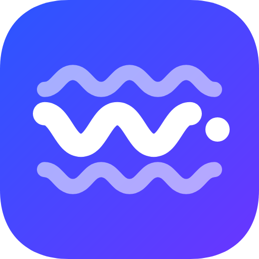
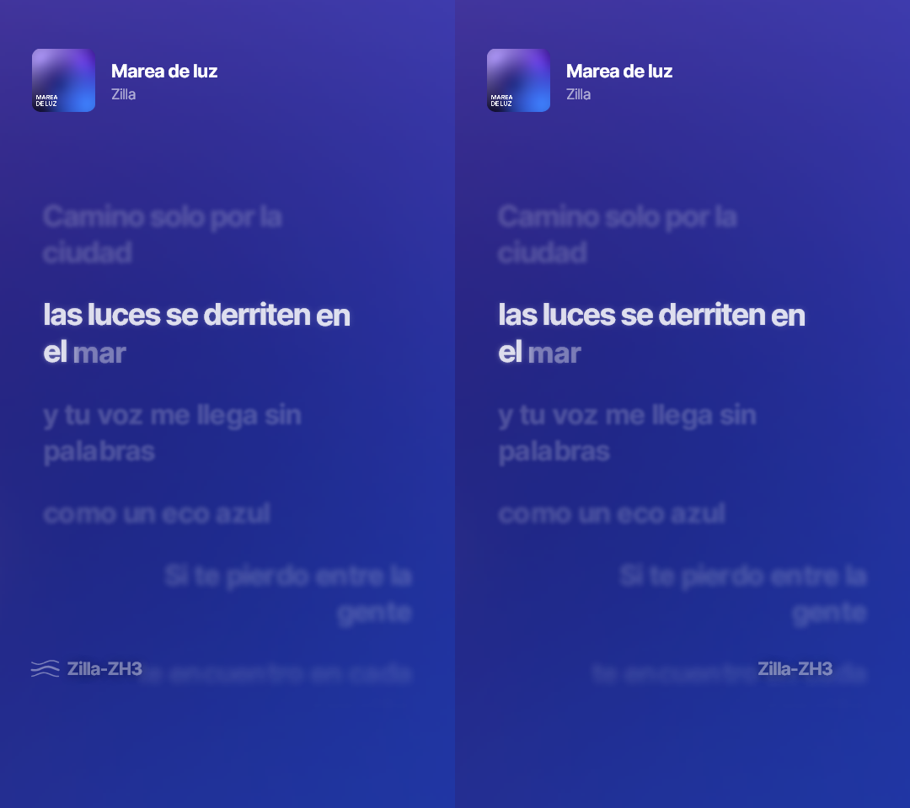
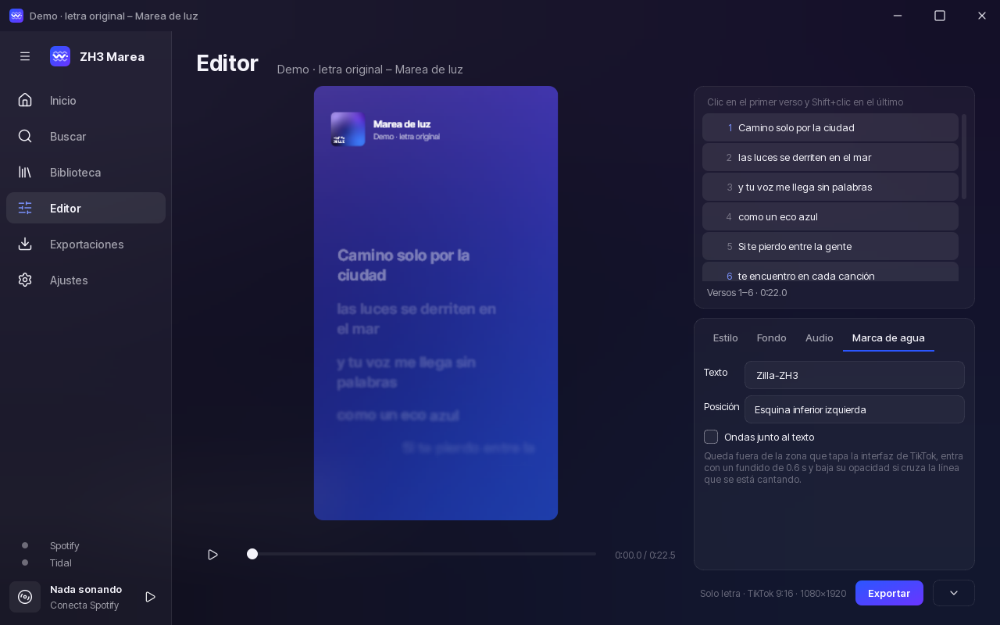
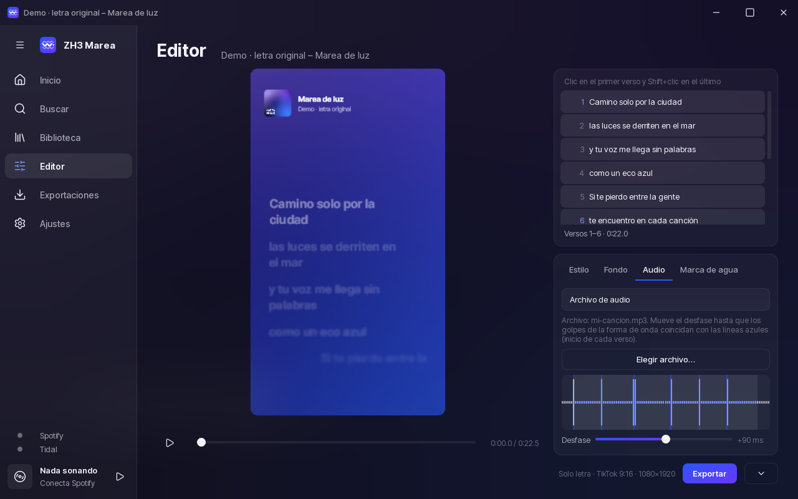
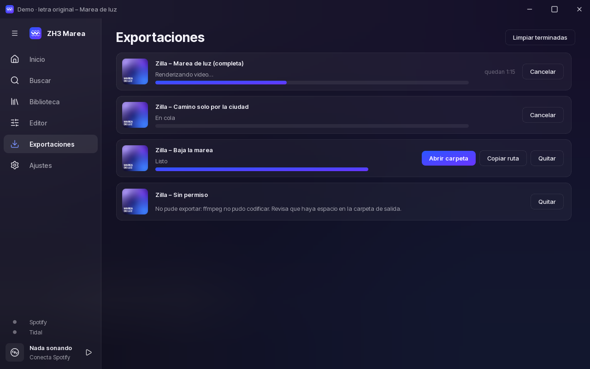
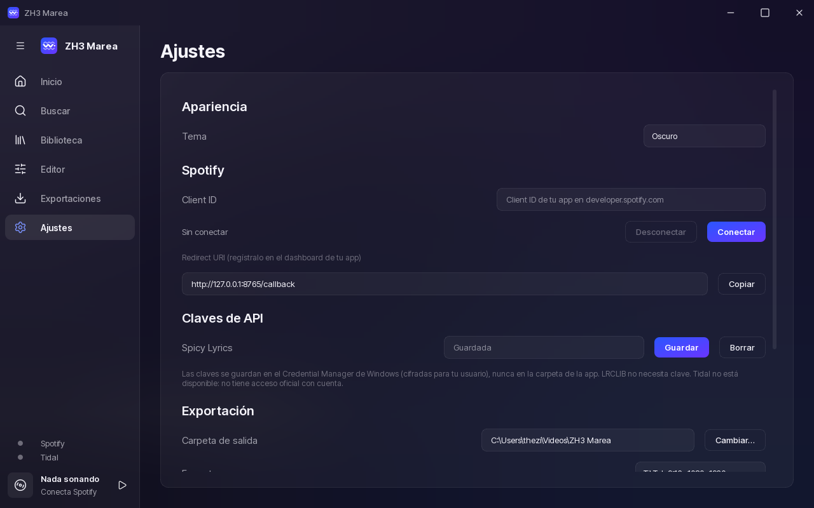
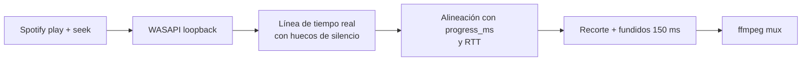

<div align="center">

🌐 [English](README.md) · **Español**



# 🌊 ZH3 Marea

**Letras sincronizadas sílaba por sílaba, estilo Apple Music, listas para TikTok.**




</div>

Elige una canción, marca el rango de versos y obtén un `.mp4` **1080×1920 a 60 fps** con la letra animada, el fondo hecho con la
portada difuminada y tu marca de agua. App **nativa** de escritorio (sin WebView ni Electron): la preview y el export usan
exactamente el mismo motor, así que lo que ves es lo que sale.

---

## ✨ Qué hace

- 🎤 **Letra por sílaba** con wipe, glow, bloom, micro-vibrato, letras que rebotan en palabras largas, duetos y voces de fondo.
- 🫧 **Fondo vivo**: la portada difuminada en varias capas que se mueven despacio, con interludios en puntos que respiran.
- 🎞️ **Tu video de fondo** o **fondo transparente**, y export con canal alfa (WebM VP9, ProRes 4444 o secuencia PNG).
- 🌊 **Corrientes**: looks guardados (Bajamar, Pleamar, Niebla, Abisal y los tuyos) que se aplican con un clic y se comparten.
- 🎣 **Anzuelo**: sugiere los mejores versos para un clip de 15, 30 o 60 s y encola variantes A/B.
- 🎬 **Tres modos**: solo letra, clip con canción y canción completa.
- 🎞️ **Export determinista**: pasos fijos de 1/60 s; el mismo trabajo da los mismos píxeles, siempre.
- ⚡ **GPU** (OpenGL vía Skia) con respaldo en CPU, y codificación por GPU opcional (NVIDIA NVENC, AMD AMF o Intel Quick Sync, detectadas solas).
- 💧 **Marca de agua** editable que respeta la zona segura de TikTok y se aparta de la línea cantada.
- 🎧 **Audio alineado**: loopback de tu propia reproducción de Spotify o archivo propio con forma de onda para ajustar el desfase.
- 🌅 **Outro ajustable**: el menú Outro extiende el rango del clip unos segundos más y desvanece el audio.
- 📝 **Cambia la letra sin perder el proyecto**: «Reemplazar letra con .ttml» en el menú del Editor conserva portada y metadatos.
- 🎨 **Efectos semánticos por palabra** (experimental, opcional): anima palabras clave en español e inglés según su significado (55 categorías: 23 emociones, 16 elementos, las 4 estaciones y los 12 meses) con color adaptativo y partículas propias.
- 🎚️ **Sincronía automática de letras** (experimental, opcional): alinea una letra con el audio y te deja revisarla.
- 📥 **Cola de exportaciones** con progreso, ETA, cancelar y abrir carpeta.
- 🔐 **Credenciales seguras**: claves y tokens en el Credential Manager de Windows, nunca en archivos.
- 🌐 **Interfaz en español e inglés**, elegida sola según el idioma de Windows.
- 📦 **Portable**: una carpeta, un `.exe`, nada que instalar.

## 🆕 Novedades en v0.2.0

- 🌐 **Interfaz en español e inglés**, con **detección automática del idioma de Windows** y un selector en **Ajustes → Apariencia → Idioma** (cambia al instante, sin reiniciar). Ver [Localización](#-localización).
- 🎞️ **Fondo de video propio y fondo transparente**, con export con canal alfa (WebM VP9, ProRes 4444 o secuencia PNG).
- 🌊 **Corrientes**: looks guardados y compartibles (Bajamar, Pleamar, Niebla y Abisal incluidos), con aplicación parcial y miniaturas.
- 🎣 **Anzuelo**: sugiere los mejores rangos de versos para clips de 15, 30 o 60 s y encola variantes A/B por Corriente.
- ⚡ **Codificación por GPU y códecs**: detección real de NVIDIA NVENC, AMD AMF e Intel Quick Sync, y elección de H.264, HEVC o AV1.
- 📚 **Biblioteca** de proyectos y clips, paleta de comandos **Ctrl+K**, Inicio y Ajustes rediseñados.
- 🎨 **Efectos semánticos por palabra v2**: configuración de efectos, variantes por categoría, puesta en escena, nuevas primitivas y galería de efectos.
- 🎚️ **Sincronía de audio más robusta**: rango de desfase local más amplio, detección del desfase con la pista vocal y superposición de depuración con **F3** en la vista previa.
- 🛡️ **Más seguridad al abrir archivos ajenos**: las rutas de red (UNC) dentro de un proyecto o de una alineación se ignoran, para que abrir un archivo compartido no haga que Windows se conecte a un recurso remoto.
- 🧭 El estado de Spotify ahora está arriba del botón de Ajustes en el menú lateral.

Lista completa en [`CHANGELOG.md`](CHANGELOG.md).

## 🖼️ Capturas

| Editor + marca de agua | Audio y forma de onda |
|:--:|:--:|
|  |  |
| **Cola de exportaciones** | **Ajustes** |
|  |  |

> Las capturas usan la canción demo con letra original y datos simulados.

## ⚡ Inicio rápido

### 📦 Opción A: portable (recomendada)

1. Descarga `ZH3-Marea-v0.2.2-portable.zip` de [Releases](https://github.com/zillazh3/ZH3-Marea/releases/latest) y descomprímelo donde quieras. Si quieres, verifica la descarga con `SHA256SUMS.txt`.
2. Abre **`ZH3 Marea.exe`**. Listo.

ffmpeg viene incluido, y la carpeta trae `README.md`, `LEEME.md` y `CHANGELOG.md`. Ajustes, caché y registro viven en `data/` junto al `.exe`, así que mover o borrar la carpeta es todo lo
que hace falta. Si la carpeta es de solo lectura, los datos pasan a `%LOCALAPPDATA%\ZH3 Marea`.

> 🩺 `ZH3 Marea.exe --selftest` exporta 1 s de video y prueba keyring y captura de audio; el resultado queda en `data/selftest.txt`.

### 🛠️ Opción B: desde el código

Necesitas Windows 10/11, Python 3.12 y ffmpeg (en el `PATH`, en `MAREA_FFMPEG` o en `ffmpeg/` junto a la app).

```powershell
git clone https://github.com/zillazh3/ZH3-Marea.git
cd ZH3-Marea
py -3.12 -m venv .venv
.\.venv\Scripts\pip install -r requirements.txt
.\.venv\Scripts\python -m marea.app
```

### 🏗️ Construir tu propio portable

```powershell
.\.venv\Scripts\python tools\build_exe.py --zip   # dist\ZH3 Marea\ and dist\ZH3-Marea-v0.2.2-portable.zip
```

> ⚖️ El ffmpeg que se empaqueta es una build GPL (Gyan): respeta su licencia si redistribuyes la carpeta.

## 🎬 Modos de exportación

| Modo | Audio | Cómo funciona |
|---|---|---|
| 📝 **Solo letra** | sin audio | exporta el rango de versos; ideal para poner el **sonido oficial desde TikTok** |
| 🎵 **Con canción** | loopback de Spotify o archivo propio | el rango de versos con el audio recortado, fundidos de 150 ms y **outro** opcional con fade out |
| 💿 **Canción completa** | loopback de Spotify o archivo propio | de principio a fin, con cola, progreso y cancelación |

**Formatos de salida** (menú del Editor → **Archivo**):

| Archivo | Códec | Transparencia | Audio |
|---|---|:--:|---|
| **MP4** | H.264 (predeterminado), HEVC o AV1 · `yuv420p` · BT.709 · `+faststart` | no | AAC 320k |
| **WebM** | VP9 (`libvpx-vp9`, `yuva420p`) | sí | Opus 192k |
| **ProRes 4444 `.mov`** | `prores_ks -profile:v 4444`, `yuva444p10le` | sí | PCM 16 bit |
| **Secuencia PNG** | carpeta de PNG RGBA numerados + `marea.json` (fps, resolución, rango) | sí | sin audio |

**Códec y GPU (solo MP4):** el códec se elige en el menú del Editor → **Códec de video** (**H.264** por defecto, el más compatible;
**HEVC** y **AV1** pesan menos pero no todas las apps los aceptan). Quién lo codifica se elige en **Ajustes → Exportación → Codificador**:
*Automático* usa la primera GPU que lo soporte (NVIDIA NVENC, AMD AMF, Intel Quick Sync, incluidas las Arc) y si no hay, la CPU
(`libx264`, `libx265`, `libsvtav1`). Al abrir la app se prueba cada combinación con un video real de unos frames, así que solo se ofrece lo que
tu equipo codifica de verdad; si eliges una GPU que no soporta el códec, se usa la CPU y se te avisa.

**Tamaños:** 1080×1920 (TikTok), 1080×1080 y 1920×1080 · 60 fps. El **marcador de inicio** (flash de 1 frame o pitido) te ayuda a
sincronizar el sonido oficial.

## 🎞️ Fondo de video y export con transparencia

Pestaña **Fondo** del Editor. El fondo puede ser:

- **Portada** (por defecto): la portada difuminada que se mueve despacio.
- **Video propio** (`.mp4`, `.mov`, `.webm`, `.mkv`): tu video detrás de la letra. Su audio se ignora. Controles: entrada y salida (recorte),
  desfase respecto al inicio del clip, al terminar (**Repetir**, **Ida y vuelta** o **Congelar último cuadro**), ajuste (**Cubrir** o
  **Contener**), zoom y posición, oscurecer, desenfoque, saturación, **velo de lectura** (degradado suave tras la letra) y un tinte opcional
  de la portada difuminada por encima.
- **Transparente**: sin fondo, para superponer la letra en tu editor de video. La vista previa muestra un tablero de ajedrez.

El cuadro del video se calcula de forma determinista a partir del tiempo del clip (recorte, desfase y modo de repetición), a la tasa de
cuadros del propio video, así que la vista previa y el export piden exactamente el mismo cuadro; los videos de velocidad variable (VFR) y
con rotación de teléfono se normalizan al decodificar. «Adaptar color de efectos al fondo» mide el cuadro real del video. Si el video
falta o cambió cuando abres el proyecto, la app vuelve a **Portada** y te avisa sin bloquearte.

**Exportar con transparencia:** elige **WebM**, **ProRes 4444** o **Secuencia PNG** en el menú del Editor → **Archivo**; el fondo cambia solo
a *Transparente* (y vuelve a MP4 si eliges otro fondo). El alfa sale **recto** (no premultiplicado), sin halos oscuros en el brillo, el
bloom ni la marca de agua (que puedes incluir o no con **Marca de agua en exports con transparencia**). Los formatos con alfa traen su propio códec y no usan la GPU.

> 📸 *Captura pendiente:* `docs/screenshots/fondo-video.png` (pestaña Fondo con video propio) y `docs/screenshots/alfa.png` (export sobre un editor de video).

## 🌊 Corrientes

Una **Corriente** es un look guardado: se aplica con un clic, se comparte como un `.json` y no incluye formato de exportación ni la ruta
de ningún video. Panel **Corrientes** al inicio de la pestaña **Estilo**:

- **Integradas:** **Bajamar** (el look de siempre, sin cambios), **Pleamar** (más atrevida: letra grande, brillo y bloom intensos),
  **Niebla** (suave: fondo muy difuminado y movimiento calmado) y **Abisal** (oscura, con acentos azul eléctrico).
- Cada una se ve con su **miniatura**, dibujada por el mismo motor sobre la canción demo.
- **Aplicar**, **Guardar como…**, **Actualizar**, y en «⋯»: renombrar, duplicar, eliminar (solo las tuyas), **importar** y **exportar** `.json`.
- **Aplicación parcial:** marca solo **Tipografía**, **Color**, **Fondo**, **Efectos** o **Marca de agua**.
- Un indicador te dice cuando el look actual está **modificado** respecto a la Corriente aplicada; el proyecto recuerda cuál fue.
- Tus Corrientes viven en `data/presets/` y se recargan solas al editar el archivo. Al importar se valida todo: se rechaza lo que pese más
  de 256 KB, se ignoran claves desconocidas, se limitan los valores y una fuente que no tengas se sustituye por Inter Tight (con aviso).

> 📸 *Captura pendiente:* `docs/screenshots/corrientes.png` (panel de Corrientes con las cuatro miniaturas).

## 🎣 Anzuelo

Botón **Sugerir rangos** en la pestaña **Anzuelo** del Editor: propone los mejores tramos de versos para un clip de **15, 30, 60 s** o una
duración a medida.

- Busca **bloques de versos repetidos** (el coro), versos con el **título**, los **picos de energía vocal** y la densidad de ataques (si hay audio
  local), las subidas de energía que marcan una entrada de sección y, como señal ligera, los efectos por palabra. Penaliza empezar en la intro,
  terminar en el outro o cortar una frase a medias.
- Cada tramo empieza en un inicio de verso (con ~0.4 s de pre-roll) y termina en un final de verso más el outro; los resultados están
  **diversificados** (sin solapes mayores al 50 %) y traen su puntaje, una explicación («coro repetido 3×, pico vocal en 1:12») y su **confianza**
  (menor sin audio local; las letras de solo líneas también funcionan).
- **Pasar el cursor** por una tarjeta resalta sus versos; **clic** la aplica al Editor. **Encolar** añade los tramos elegidos a la cola con los
  ajustes actuales; **Encolar variantes…** añade el mismo tramo una vez por Corriente elegida (pruebas A/B), con el nombre de la Corriente en el archivo.
- Los pesos están en `assets/hooks/weights.json` (se recarga solo; una copia en `data/hooks/` tiene prioridad).

> 📸 *Captura pendiente:* `docs/screenshots/anzuelo.png` (tarjetas de sugerencias).

## 💧 Marca de agua

Pestaña **Marca de agua** del Editor:

- Texto editable (por defecto `Zilla-ZH3`), esquina inferior izquierda o derecha y glifo de ondas opcional.
- Se coloca **por encima del 15 % inferior** y lejos de la columna de botones de TikTok.
- Entra con un fundido de **0.6 s**, con sombra suave y opacidad 40 %.
- Si la línea que se canta baja hasta ella, **baja su opacidad** en vez de taparla.

## 🎵 Spotify

1. Crea una app en <https://developer.spotify.com/dashboard> y activa **Web API**.
2. Registra exactamente este **Redirect URI**: `http://127.0.0.1:8765/callback` (Spotify no acepta `localhost`).
3. En **Ajustes** pega el **Client ID** y pulsa **Conectar**. Se usa PKCE: no hay client secret, y el token se guarda en el
   Credential Manager de Windows.
4. Si tu app está en modo desarrollo, tu cuenta debe estar en la lista de usuarios del dashboard.

Grabar el audio de Spotify (modo «Con canción» → Loopback) **requiere Spotify Premium**: la app pide `play` + `seek`.

## 🎧 Grabar audio por loopback



1. En **Ajustes → Audio** elige el dispositivo de captura. «Probar captura» mide el nivel mientras suena algo.
2. El **desfase** compensa la latencia de tu equipo (positivo = el audio llega tarde).
3. **Voicemeeter / mezcladores virtuales:** el loopback de sus salidas virtuales suele dar silencio. Elige una de sus entradas
   «Voicemeeter Out B1/B2» (aparecen como «· entrada») o un altavoz físico.
4. Durante la grabación no pauses ni cambies de canción, y evita otros sonidos.

¿Sin Spotify? Usa **Archivo de audio**: la pestaña Audio muestra la forma de onda frente al inicio de cada verso para ajustar el
desfase a ojo.

**Medido en hardware real:** latencia de captura 10.5 ± 0.7 ms · clics en el mp4 final con error 0.0 ms (audio local) ·
alineación con Spotify simulada < 40 ms.

## 📝 Letras

| Fuente | Estado | Detalle |
|---|---|---|
| 📄 **TTML** local | ✅ | formato de Apple Music: tiempos por sílaba, duetos y voces de fondo |
| 🌐 **LRCLIB** | ✅ | pública y sin llave; sincronía por línea (por palabra si el `lyricsfile` la trae); caché local |
| 🌶️ **Spicy Lyrics** | ✅ | letra por sílaba de Apple Music o de la comunidad, por id de Spotify; llave de cliente `sl_pk_…` (con «Allow requests with no Origin header») en Ajustes; va primero y LRCLIB queda de respaldo; el crédito se muestra en el Editor |
| 🌀 **Tidal** | ❌ | sin acceso oficial con cuenta; igual puedes grabar su audio por loopback |

## 🎚️ Sincronía automática de letras (experimental)

Alinea una letra con el audio de tu canción (línea → palabra → sílaba, con la vocal solo como aproximación) y te deja **revisarla antes de
exportar un TTML nuevo**. Está **apagada por defecto**: actívala en **Ajustes → Funciones experimentales**; con ella apagada la app se comporta
exactamente igual y no carga nada de esto.

- **Modo A (ya tienes la letra):** abre tu `.ttml` con sílabas y elige **Sincronizar con audio** en el menú del Editor; conserva tu texto, agentes y
  voces de fondo y solo corrige los tiempos. **Modo B (no hay letra):** Whisper propone un borrador que tú corriges y luego se alinea.
- **Revisión:** línea de tiempo con forma de onda, color por confianza, lista de lo que requiere revisión, edición arrastrando o con números,
  escuchar desde cualquier unidad, desfase global aparte, recalcular una sección sin reprocesar la canción y vista previa en el Editor.
- **Tu archivo original nunca se modifica:** el resultado se exporta a un `*.aligned.ttml` nuevo (y un `.alignment.json` con todo el detalle) en la carpeta `letras/` de los datos de la app, no junto a tus clips.
- **Cómo funciona:** corre en un proceso aparte (`sidecar/`, con torch) que se instala solo si lo pides (≈ 4.5 GB más modelos bajo demanda dentro de
  `lab/`; borrar esa carpeta lo desinstala). Necesita una GPU NVIDIA para ser cómodo (probado en una RTX 5060); no se descarga nada sin que lo pidas.
- **Qué esperar:** funciona muy bien con voz clara (~92–97 % de inicios de palabra a ±100 ms) y mucho mejor con **separar la voz** en música densa,
  pero **no es mágico**: en rock saturado o voces muy arrastradas queda por debajo y la app te lo dice marcando más unidades para revisar. Solo
  español e inglés por ahora.
- **Descarga de modelos:** en **Ajustes → Funciones experimentales**, instala el entorno opcional y pulsa **Descargar** en
  **Voz principal/coros · Karaoke (0.9 GB)** y, si hace falta, en **BS-Roformer**. El botón **Descargar modelo en Ajustes** de la ventana de
  sincronía abre esa fila sin perder tu borrador. Los archivos viven en la carpeta `separator-models` del laboratorio configurado (por defecto
  `data/lab/separator-models` junto al EXE). Cancelar y reintentar conserva los modelos ya instalados; nunca se descarga nada automáticamente.
- **Licencias:** el código de audio-separator es MIT; los permisos de los pesos de los modelos siguen sin resolverse. Revisa la
  [pregunta sobre la licencia de Karaoke](https://github.com/Anjok07/ultimatevocalremovergui/issues/2295) antes de descargar. Los pesos no se incluyen.

## 🎨 Efectos semánticos por palabra (experimental)

Reacciona al **significado y emoción** de palabras clave dentro de cada verso (en español e inglés) con animaciones suaves que se mantienen alineadas con la letra y salen **idénticas** en la vista previa y en el video exportado. Está **apagada por defecto**: actívala en **Ajustes → Funciones experimentales → Efectos semánticos por palabra**.

- **Entiende contexto, no solo palabras sueltas:** reconoce **55 categorías** (23 emociones como tristeza, amor, alegría, angustia o sanación; 16 elementos como agua, fuego o luz; las 4 estaciones; y los 12 meses del año). Distingue frases (*para siempre*, *flor de papel*, *let go*), negaciones y giros (*sin miedo*, *no puedo respirar*, *volví a respirar*), palabras opuestas en el mismo verso y repeticiones que evolucionan a lo largo de la canción.
- **Partículas y detalles visuales propios:**
  - **Estaciones y meses:** pétalos flotantes en primavera, luciérnagas cálidas en verano, hojas cayendo en otoño, copos de nieve en invierno y matices propios para cada mes.
  - **Elementos y emociones:** brasas de fuego, lluvia, lágrimas que resbalan y abren ondas abajo (*llorar* / *cry*), gotas carmesí desde un corte (*herida* / *wound*), costura dorada tipo *kintsugi* (*cicatriz* / *scar*), burbujas en el agua, bruma suave en nubes, esquirlas rotas, halos brillantes y semillas al viento.
- **Controles sencillos en el Editor:**
  - En la pestaña **Estilo** puedes ajustar **Intensidad FX** (de `0 %` para apagarlos temporalmente hasta reforzarlos), activar **Adaptar color de efectos al fondo** para mantener buena lectura sobre portadas o videos claros/oscuros sin perder el tono, y usar **Depurar efectos por palabra** para ver en la vista previa qué detectó cada palabra (nunca sale en el export).
  - En el menú del Editor (**Perfil de la canción (efectos por palabra)…**) puedes ajustar el ánimo general, cambiar secciones en la línea de tiempo y añadir notas; si usas un archivo de audio propio, los efectos también responden al ritmo y a la intensidad vocal.
- **Personalizable (opcional):** si quieres agregar palabras, reglas o ajustes por canción sin recompilar, consulta [`docs/wordfx.md`](docs/wordfx.md); tus cambios se recargan solos en la vista previa al guardar.

## 🌐 Localización

- **Idiomas de la interfaz:** español y English.
- **Detección automática:** en el primer arranque (y en cada arranque mientras el ajuste siga en «Sistema (automático)») la app lee los idiomas
  preferidos de Windows y elige el primero que soporta, por idioma base (es-MX, es-ES y es-AR → español; en-US y en-GB → inglés). Si tu
  idioma no está soportado, usa inglés.
- **Selector:** **Ajustes → Apariencia → Idioma** (*Sistema (automático)*, *Español* o *English*). El cambio es inmediato, sin reiniciar. La
  elección se guarda como `language` (`system`, `es` o `en`) en `settings.ini`.
- **Forzar un idioma (desarrollo y QA):** variable de entorno `MAREA_LANG=es` o `MAREA_LANG=en`.
- **Orden de respaldo:** idioma elegido → inglés → la clave misma.
- **Qué no se traduce:** el nombre de la app, la marca de agua «Zilla-ZH3», los nombres de Spotify, Tidal, Spicy Lyrics y TikTok, los
  formatos de archivo y el contenido de canciones y letras. Los efectos semánticos por palabra dependen del idioma de la **letra**, no del de
  la interfaz. **Corrientes** y **Anzuelo** conservan su nombre en ambos idiomas (en inglés se añade un descriptor: «Corrientes — style presets»,
  «Anzuelo — hook finder»).

**Agregar un idioma:**

1. Copia `assets/i18n/en.json` a `assets/i18n/<código>.json`.
2. Pon el nombre del idioma en su propia lengua en `_meta.name` y traduce los valores (conserva los `{marcadores}` y las formas plurales
   `{"one": ..., "other": ...}`).
3. Añade el código a `SUPPORTED` en `marea/i18n.py`. Aparece solo en el selector de Ajustes.

**Revisar las claves:**

```powershell
.\.venv\Scripts\python tools\check_i18n.py   # sale con código 1 si faltan o sobran claves, o no coinciden los {marcadores}
```

Detecta claves faltantes o de más, marcadores que no coinciden, claves usadas sin definir o definidas sin usar y claves dinámicas. También lo
cubre `pytest tests/test_i18n.py`. Los catálogos son JSON anidado (se aplanan a claves con puntos); el código usa `t("clave", param=valor)` de
`marea/i18n.py`, y `marea/ui/lang.py` retraduce la interfaz en vivo.

## 🔐 Seguridad y datos

- Las **claves de API y tokens** van al **Credential Manager** de Windows (cifrado por usuario). Nada de secretos en `data/`,
  en los ajustes ni en el repo.
- Las consultas a APIs van espaciadas y con caché, respetando sus límites.
- Todo se procesa **en tu equipo**: no hay servidores propios ni telemetría.

## ⚖️ Uso responsable

> [!WARNING]
> **Publicar audio con derechos de autor puede provocar silenciamientos, reclamos o bajas.** La opción más segura es el modo
> **«Solo letra»**: exporta el video sin audio para que le pongas el **sonido oficial desde TikTok**.

- **No se elimina DRM ni se descarga audio por vías no oficiales.** El audio solo sale del loopback de **tu propia reproducción** o
  de **archivos que tú tengas**.
- Grabar lo que suena en tu equipo puede ir contra los términos de uso de tu servicio de streaming. **Eso queda bajo tu
  responsabilidad:** revisa los términos de cada uno.
- Las letras pertenecen a sus autores; la app no las incluye, las consulta de fuentes públicas o de archivos tuyos.

## 🧪 Desarrollo

```powershell
.\.venv\Scripts\python -m pytest tests -q          # +1400 tests (usa ffmpeg y, si hay, OpenGL en subprocesos); los de audio real de la sincronía son opt-in: MAREA_LAB_DIR
.\.venv\Scripts\python tools\measure_loopback.py    # mide la captura con hardware real (suenan clics suaves)
.\.venv\Scripts\python tools\check_i18n.py            # revisa los catálogos de idioma (es/en)
```

### 🗺️ Estructura

```text
marea/
├─ i18n.py      traducciones: t(), detección de idioma y catálogos (assets/i18n/*.json)
├─ engine/      animación pura: springs, splines, layout, interludios (sin dependencias de UI)
├─ render/      Skia: escena, fondo, texto, GPU/CPU, marca de agua
├─ wordfx/      efectos semánticos por palabra: léxico, reglas, compositor, firmas y partículas
├─ export/      ffmpeg por pipe, proceso de render aparte, cola e historial
├─ audio/       loopback WASAPI, alineación, audio local, sesión de grabación
├─ providers/   Spotify (PKCE), LRCLIB, TTML
├─ lab/         (experimental) esquema alignment.v1, sesión de revisión, cliente del sidecar, instalador
├─ model/       lyrics: Syllable / Line / Interlude y parsers
└─ ui/          PySide6: ventana, Editor, Biblioteca, Exportaciones, Ajustes, tema por tokens, retraducción en vivo (lang.py)
sidecar/        (experimental) proceso aparte con torch y modelos; la app nunca lo importa
tools/          iconos, referencias del motor, build del .exe, mediciones, evaluación de la sincronía
assets/         fuentes, íconos, logo, catálogos de idioma (i18n/) y la canción demo
```

El motor es un port de un prototipo propio en JavaScript (no incluido) y se valida con tests numéricos contra valores congelados en `tests/fixtures/`.

## 🙏 Créditos

El motor de animación se inspira en y porta valores de [Apple Music-like Lyrics](https://github.com/amll-dev/applemusic-like-lyrics) y
[Spicy Lyrics](https://github.com/Spikerko/spicy-lyrics) (ambos AGPL-3.0), y el spring analítico de `spr` de Fraktality. Letras de
[LRCLIB](https://lrclib.net) y Spicy Lyrics. Hecho con [Skia](https://skia.org), [Qt for Python](https://doc.qt.io/qtforpython-6/),
[ffmpeg](https://ffmpeg.org), [PyAudioWPatch](https://github.com/s0d3s/PyAudioWPatch), [Inter Tight](https://fonts.google.com/specimen/Inter+Tight) (OFL) y
[Lucide](https://lucide.dev) (ISC). Lista completa de licencias en [`THIRD_PARTY.md`](THIRD_PARTY.md).

## 📜 Licencia

[**GNU AGPL-3.0**](LICENSE) © 2026 Zilla-ZH3. Puedes usarlo, estudiarlo y modificarlo; si distribuyes una versión modificada o la ofreces como
servicio, debes publicar tu código bajo la misma licencia y conservar los créditos. Apple Music, Spotify, TikTok y Tidal son marcas de sus dueños;
este proyecto no está afiliado a ellos.

## 🛡️ Reportar una vulnerabilidad

Usa **Security → Report a vulnerability** en GitHub (aviso privado). No abras un issue público con datos sensibles.

<div align="center">

Hecho con 🌊 por **Zilla-ZH3**

</div>
