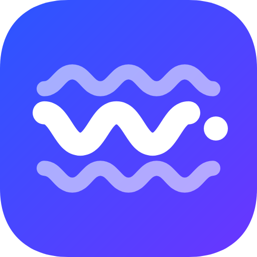
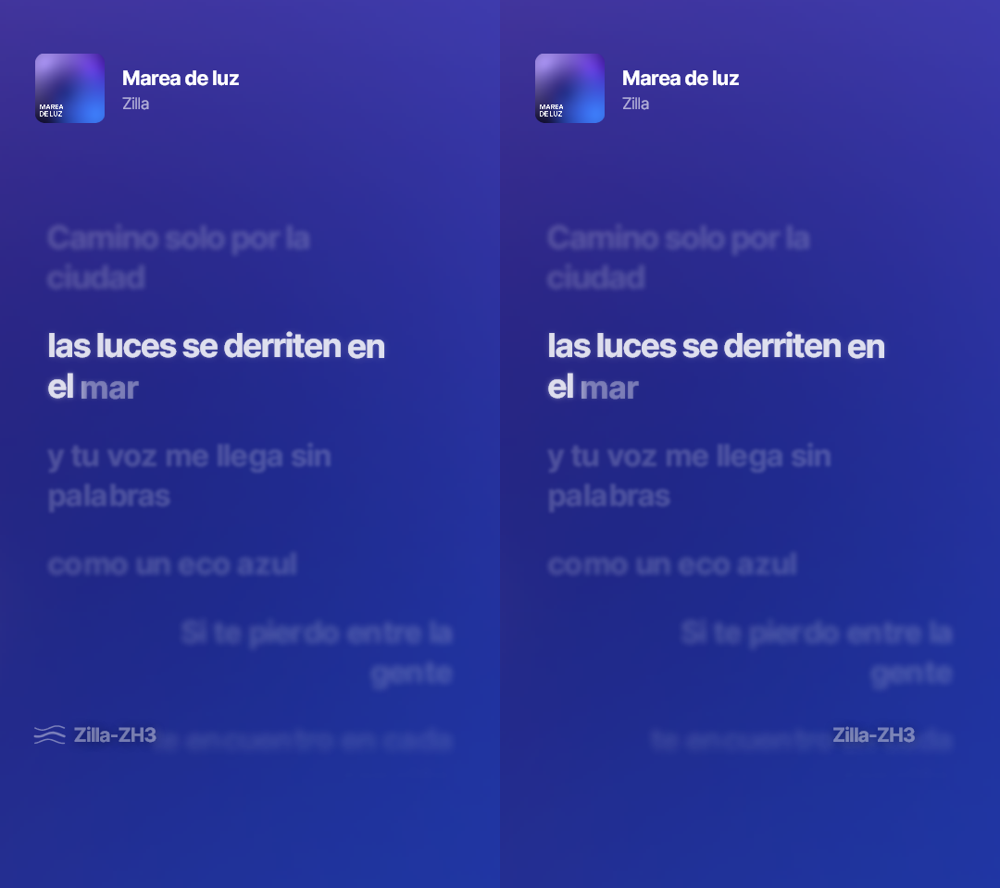
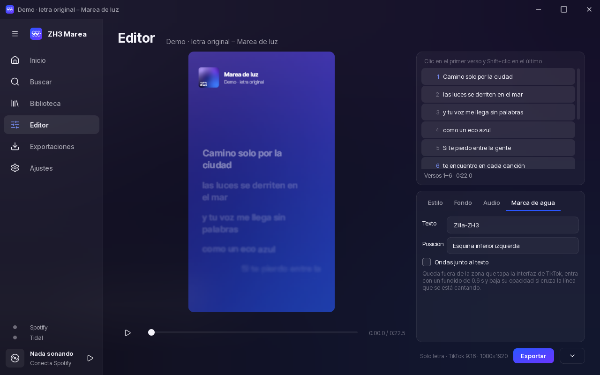
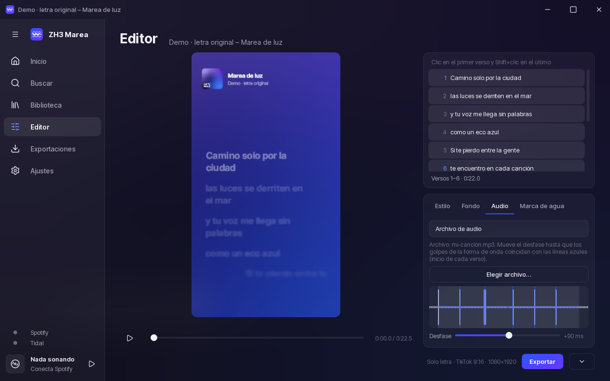
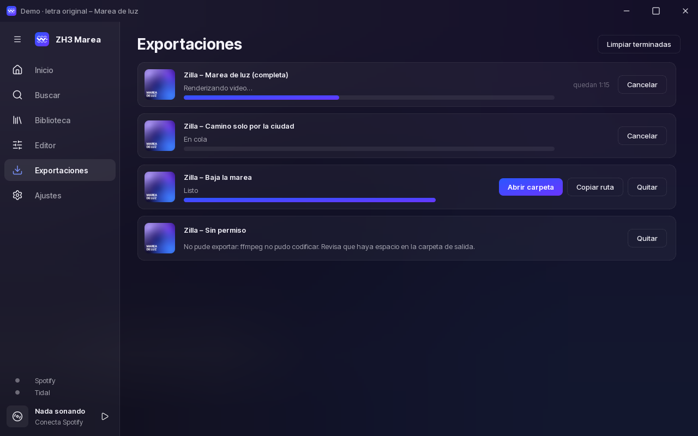
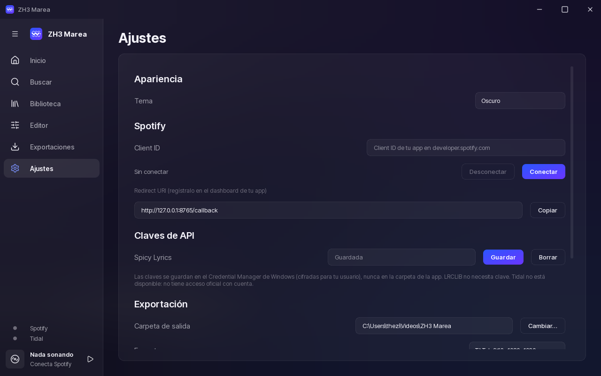
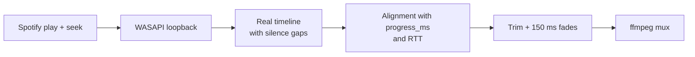

<div align="center">

🌐 **English** · [Español](LEEME.md)



# 🌊 ZH3 Marea

**Syllable-synced lyrics, Apple Music style, ready for TikTok.**




</div>

Pick a song, choose a range of lines, and get a **1080×1920, 60 fps** `.mp4` with animated lyrics, a background built from the blurred
cover art, and your watermark. It is a **native** desktop app (no WebView, no Electron): the preview and the export use exactly the same
engine, so what you see is what you get.

---

## ✨ What it does

- 🎤 **Syllable-by-syllable lyrics** with wipe, glow, bloom, micro-vibrato, bouncing letters on long words, duets and backing vocals.
- 🫧 **Living background**: the blurred cover art in several slowly moving layers, with breathing dots during instrumental breaks.
- 🎞️ **Your own background video** or a **transparent background**, plus alpha-channel export (WebM VP9, ProRes 4444 or PNG sequence).
- 🌊 **Corrientes**: saved looks (Bajamar, Pleamar, Niebla, Abisal and your own) that you apply in one click and share.
- 🎣 **Anzuelo**: suggests the best lines for a 15, 30 or 60 s clip and queues A/B variants.
- 🎬 **Three modes**: lyrics only, clip with song, and full song.
- 🎞️ **Deterministic export**: fixed 1/60 s steps; the same job always produces the same pixels.
- ⚡ **GPU** (OpenGL through Skia) with a CPU fallback, and optional GPU encoding (NVIDIA NVENC, AMD AMF or Intel Quick Sync, detected automatically).
- 💧 **Editable watermark** that respects TikTok's safe zone and steps aside from the line being sung.
- 🎧 **Aligned audio**: loopback of your own Spotify playback or your own file, with a waveform to fine-tune the offset.
- 🌅 **Adjustable outro**: the Outro menu extends the clip range by a few seconds and fades the audio out.
- 📝 **Change the lyrics without losing the project**: "Replace lyrics with .ttml" in the Editor menu keeps the cover art and metadata.
- 🎨 **Semantic per-word effects** (experimental, optional): animates keywords in Spanish and English by meaning (55 categories: 23 emotions, 16 elements, the 4 seasons and the 12 months) with adaptive color and custom particles.
- 🎚️ **Automatic lyrics sync** (experimental, optional): aligns lyrics with the audio and lets you review the result.
- 📥 **Export queue** with progress, ETA, cancel and open-folder.
- 🔐 **Secure credentials**: keys and tokens live in the Windows Credential Manager, never in files.
- 🌐 **English and Spanish UI**, picked automatically from your Windows language.
- 📦 **Portable**: one folder, one `.exe`, nothing to install.

## 🆕 What's new in v0.2.0

- 🌐 **English and Spanish interface**, with **automatic detection of your Windows language** and a selector in **Settings → Appearance → Language** (switches instantly, no restart). See [Localization](#-localization).
- 🎞️ **Own-video and transparent backgrounds**, with alpha-channel export (WebM VP9, ProRes 4444 or PNG sequence).
- 🌊 **Corrientes**: saved, shareable looks (Bajamar, Pleamar, Niebla and Abisal included), with partial apply and thumbnails.
- 🎣 **Anzuelo**: suggests the best line ranges for 15, 30 or 60 s clips and queues A/B variants per Corriente.
- ⚡ **GPU encoding and codecs**: real detection of NVIDIA NVENC, AMD AMF and Intel Quick Sync, and a choice of H.264, HEVC or AV1.
- 📚 **Library** of projects and clips, a **Ctrl+K** command palette, and a redesigned Home and Settings.
- 🎨 **Semantic per-word effects v2**: effects configuration, per-category variants, staging, new primitives and an effects gallery.
- 🎚️ **More robust audio sync**: wider local offset range, offset detection using the vocal stem, and an **F3** debug overlay in the preview.
- 🛡️ **Safer opening of shared files**: network (UNC) paths inside a project or an alignment file are ignored, so opening a shared file can't make Windows contact a remote share.
- 🧭 The Spotify status now sits above the Settings button in the sidebar.

Full list in [`CHANGELOG.md`](CHANGELOG.md).

## 🖼️ Screenshots

| Editor + watermark | Audio and waveform |
|:--:|:--:|
|  |  |
| **Export queue** | **Settings** |
|  |  |

> Screenshots show the Spanish UI. They use the demo song with original lyrics and simulated data.

## ⚡ Quick start

### 📦 Option A: portable (recommended)

1. Download `ZH3-Marea-v0.2.2-portable.zip` from [Releases](https://github.com/zillazh3/ZH3-Marea/releases/latest) and unzip it anywhere. You can verify the download with `SHA256SUMS.txt`.
2. Open **`ZH3 Marea.exe`**. Done.

ffmpeg is included, and the folder contains `README.md`, `LEEME.md` and `CHANGELOG.md`. Settings, cache and log live in `data/` next to
the `.exe`, so moving or deleting the folder is all it takes. If the folder is read-only, the data goes to `%LOCALAPPDATA%\ZH3 Marea` instead.

> 🩺 `ZH3 Marea.exe --selftest` exports 1 s of video and tests the keyring and audio capture; the result is saved to `data/selftest.txt`.

### 🛠️ Option B: from source

You need Windows 10/11, Python 3.12 and ffmpeg (on the `PATH`, in `MAREA_FFMPEG`, or in `ffmpeg/` next to the app).

```powershell
git clone https://github.com/zillazh3/ZH3-Marea.git
cd ZH3-Marea
py -3.12 -m venv .venv
.\.venv\Scripts\pip install -r requirements.txt
.\.venv\Scripts\python -m marea.app
```

### 🏗️ Build your own portable

```powershell
.\.venv\Scripts\python tools\build_exe.py --zip   # dist\ZH3 Marea\ and dist\ZH3-Marea-v0.2.2-portable.zip
```

> ⚖️ The bundled ffmpeg is a GPL build (Gyan): respect its license if you redistribute the folder.

## 🎬 Export modes

| Mode | Audio | How it works |
|---|---|---|
| 📝 **Lyrics only** | none | exports the line range; ideal for adding the **official sound from TikTok** |
| 🎵 **With song** | Spotify loopback or your own file | the line range with the audio trimmed, 150 ms fades and an optional **outro** with fade-out |
| 💿 **Full song** | Spotify loopback or your own file | start to finish, with queue, progress and cancellation |

**Output formats** (Editor menu → **File**):

| File | Codec | Transparency | Audio |
|---|---|:--:|---|
| **MP4** | H.264 (default), HEVC or AV1 · `yuv420p` · BT.709 · `+faststart` | no | AAC 320k |
| **WebM** | VP9 (`libvpx-vp9`, `yuva420p`) | yes | Opus 192k |
| **ProRes 4444 `.mov`** | `prores_ks -profile:v 4444`, `yuva444p10le` | yes | 16-bit PCM |
| **PNG sequence** | folder of numbered RGBA PNGs + `marea.json` (fps, resolution, range) | yes | no audio |

**Codec and GPU (MP4 only):** pick the codec in the Editor menu → **Video codec** (**H.264** by default, the most compatible; **HEVC** and
**AV1** are smaller but not every app accepts them). Who encodes it is chosen in **Settings → Export → Encoder**: *Automatic* uses the first
GPU that supports it (NVIDIA NVENC, AMD AMF, Intel Quick Sync, Arc included) and falls back to the CPU (`libx264`, `libx265`, `libsvtav1`) if
there is none. When the app starts, it tests every combination with a real few-frame encode, so it only offers what your machine can truly
encode; if you pick a GPU that does not support the codec, the CPU is used and you get a notice.

**Sizes:** 1080×1920 (TikTok), 1080×1080 and 1920×1080 · 60 fps. The **start marker** (a 1-frame flash or a beep) helps you sync the
official sound.

## 🎞️ Video background and transparent export

**Background** tab in the Editor. The background can be:

- **Cover art** (default): the blurred cover art that moves slowly.
- **Own video** (`.mp4`, `.mov`, `.webm`, `.mkv`): your video behind the lyrics. Its audio is ignored. Controls: in and out points (trim),
  offset from the clip start, what happens at the end (**Loop**, **Ping-pong** or **Freeze last frame**), fit (**Cover** or **Contain**),
  zoom and position, dim, blur, saturation, a **readability scrim** (a soft gradient behind the lyrics) and an optional tint from the blurred
  cover on top.
- **Transparent**: no background, so you can overlay the lyrics in your video editor. The preview shows a checkerboard.

The video frame is computed deterministically from the clip time (trim, offset and loop mode), at the video's own frame rate, so the preview
and the export request exactly the same frame; variable-frame-rate (VFR) videos and phone-rotated ones are normalized when decoding.
"Match effect color to the background" measures the video's actual frame. If the video is missing or changed when you open the project, the app
goes back to **Cover art** and tells you, without blocking you.

**Exporting with transparency:** pick **WebM**, **ProRes 4444** or **PNG sequence** in the Editor menu → **File**; the background switches to
*Transparent* automatically (and back to MP4 if you choose another background). Alpha comes out **straight** (not premultiplied), with no dark
halos on the glow, the bloom or the watermark (which you can include or not with **Watermark in transparent exports**). Formats with alpha
ship with their own codec and do not use the GPU.

> 📸 *Screenshot pending:* `docs/screenshots/fondo-video.png` (Background tab with own video) and `docs/screenshots/alfa.png` (export over a video editor).

## 🌊 Corrientes

A **Corriente** (a "current", in Spanish) is a saved look: you apply it in one click, share it as a `.json`, and it includes neither the export
format nor the path of any video. **Corrientes** panel at the top of the **Style** tab:

- **Built in:** **Bajamar** (the classic look, unchanged), **Pleamar** (bolder: big lyrics, intense glow and bloom), **Niebla** (soft: a
  very blurred background and calm motion) and **Abisal** (dark, with electric-blue accents).
- Each one shows a **thumbnail**, drawn by the same engine over the demo song.
- **Apply**, **Save as…**, **Update**, and under "⋯": rename, duplicate, delete (yours only), **import** and **export** `.json`.
- **Partial apply:** tick only **Typography**, **Color**, **Background**, **Effects** or **Watermark**.
- An indicator tells you when the current look is **modified** relative to the applied Corriente; the project remembers which one it was.
- Your Corrientes live in `data/presets/` and reload on their own when you edit the file. Importing validates everything: anything over
  256 KB is rejected, unknown keys are ignored, values are clamped, and a font you do not have is replaced with Inter Tight (with a notice).

> 📸 *Screenshot pending:* `docs/screenshots/corrientes.png` (Corrientes panel with the four thumbnails).

## 🎣 Anzuelo

The **Suggest ranges** button in the Editor's **Anzuelo** tab ("hook", in Spanish) proposes the best stretches of lines for a **15, 30, 60 s**
or custom-length clip.

- It looks for **repeated blocks of lines** (the chorus), lines containing the **title**, **vocal energy peaks** and attack density (when
  there is local audio), energy rises that mark a section entry, and, as a light signal, the per-word effects. It penalizes starting in the
  intro, ending in the outro or cutting a phrase in half.
- Each range starts at the beginning of a line (with ~0.4 s of pre-roll) and ends at the end of a line plus the outro; results are
  **diversified** (no overlap above 50%) and come with a score, an explanation ("chorus repeated 3×, vocal peak at 1:12") and a
  **confidence** level (lower without local audio; line-only lyrics work too).
- **Hovering** a card highlights its lines; **clicking** applies it to the Editor. **Queue** adds the chosen ranges to the queue with the
  current settings; **Queue variants…** adds the same range once per chosen Corriente (A/B testing), with the Corriente's name in the file name.
- The weights are in `assets/hooks/weights.json` (reloaded automatically; a copy in `data/hooks/` takes priority).

> 📸 *Screenshot pending:* `docs/screenshots/anzuelo.png` (suggestion cards).

## 💧 Watermark

**Watermark** tab in the Editor:

- Editable text (default `Zilla-ZH3`), bottom-left or bottom-right corner, and an optional waves glyph.
- It sits **above the bottom 15%** and away from TikTok's button column.
- It fades in over **0.6 s**, with a soft shadow and 40% opacity.
- If the line being sung drops down to it, it **lowers its opacity** instead of covering the line.

## 🎵 Spotify

1. Create an app at <https://developer.spotify.com/dashboard> and enable **Web API**.
2. Register exactly this **Redirect URI**: `http://127.0.0.1:8765/callback` (Spotify does not accept `localhost`).
3. In **Settings**, paste the **Client ID** and click **Connect**. PKCE is used: there is no client secret, and the token is stored in the
   Windows Credential Manager.
4. If your app is in development mode, your account must be on the dashboard's user list.

Recording Spotify's audio ("With song" mode → Loopback) **requires Spotify Premium**: the app requests `play` + `seek`.

## 🎧 Recording audio through loopback



1. In **Settings → Audio**, choose the capture device. "Test capture" measures the level while something is playing.
2. The **offset** compensates for your machine's latency (positive = the audio arrives late).
3. **Voicemeeter / virtual mixers:** loopback on their virtual outputs usually yields silence. Pick one of their inputs,
   "Voicemeeter Out B1/B2" (they appear as "· input"), or a physical speaker.
4. While recording, do not pause or change songs, and avoid other sounds.

No Spotify? Use **Audio file**: the Audio tab shows the waveform against the start of each line so you can adjust the offset by eye.

**Measured on real hardware:** capture latency 10.5 ± 0.7 ms · clicks in the final mp4 with 0.0 ms error (local audio) ·
simulated Spotify alignment < 40 ms.

## 📝 Lyrics

| Source | Status | Details |
|---|---|---|
| 📄 **Local TTML** | ✅ | Apple Music's format: per-syllable timing, duets and backing vocals |
| 🌐 **LRCLIB** | ✅ | public, no key; line-level sync (word-level if the `lyricsfile` includes it); local cache |
| 🌶️ **Spicy Lyrics** | ✅ | per-syllable lyrics from Apple Music or the community, by Spotify id; client key `sl_pk_…` (with "Allow requests with no Origin header") in Settings; it goes first and LRCLIB is the fallback; credit is shown in the Editor |
| 🌀 **Tidal** | ❌ | no official account access; you can still record its audio through loopback |

## 🎚️ Automatic lyrics sync (experimental)

Aligns lyrics with your song's audio (line → word → syllable, with the vowel only as an approximation) and lets you **review it before
exporting a new TTML**. It is **off by default**: turn it on in **Settings → Experimental features**; with it off, the app behaves exactly
the same and loads none of this.

- **Mode A (you already have the lyrics):** open your `.ttml` with syllables and choose **Sync with audio** in the Editor menu; it keeps your
  text, agents and backing vocals and only fixes the timing. **Mode B (no lyrics):** Whisper proposes a draft that you correct, and then it
  is aligned.
- **Review:** a timeline with waveform, color by confidence, a list of what needs review, editing by dragging or with numbers, listening
  from any unit, a separate global offset, recomputing a section without reprocessing the song, and a preview in the Editor.
- **Your original file is never modified:** the result is exported to a new `*.aligned.ttml` (and an `.alignment.json` with all the detail) in
  the `letras/` folder of the app's data, not next to your clips.
- **How it works:** it runs in a separate process (`sidecar/`, with torch) that is installed only if you ask for it (≈ 4.5 GB plus models on
  demand inside `lab/`; deleting that folder uninstalls it). It needs an NVIDIA GPU to be comfortable (tested on an RTX 5060); nothing is
  downloaded unless you ask.
- **What to expect:** it works very well with clear vocals (~92–97% of word starts within ±100 ms) and much better with **vocal separation**
  on dense music, but it is **not magic**: on saturated rock or very drawn-out vocals it falls short, and the app tells you by flagging more
  units for review. Spanish and English only for now.
- **Model download:** under **Settings → Experimental features**, install the optional environment, then click **Download** for
  **Lead/backing vocals · Karaoke (0.9 GB)** and **BS-Roformer** if needed. The synchronization window's **Download model in Settings**
  button opens the row without losing your draft. Assets live in the configured lab's `separator-models` folder (by default
  `data/lab/separator-models` beside the EXE). Cancellation and retry preserve installed models; no download starts automatically.
- **Licenses:** audio-separator code is MIT licensed; model weight permissions remain unresolved. Review the
  [karaoke licensing question](https://github.com/Anjok07/ultimatevocalremovergui/issues/2295) before downloading. Weights are not bundled.

## 🎨 Semantic per-word effects (experimental)

Reacts to the **meaning and emotion** of keywords inside each line (in Spanish and English) with smooth animations that stay aligned with
the lyrics and come out **identical** in the preview and the exported video. It is **off by default**: turn it on in **Settings →
Experimental features → Semantic per-word effects**.

- **It understands context, not just isolated words:** it recognizes **55 categories** (23 emotions such as sadness, love, joy, anguish or
  healing; 16 elements such as water, fire or light; the 4 seasons; and the 12 months of the year). It tells phrases apart (*para siempre*,
  *flor de papel*, *let go*), negations and twists (*sin miedo*, *no puedo respirar*, *volví a respirar*), opposite words in the same line,
  and repetitions that evolve over the course of the song.
- **Custom particles and visual details:**
  - **Seasons and months:** floating petals in spring, warm fireflies in summer, falling leaves in autumn, snowflakes in winter, and
    distinct touches for each month.
  - **Elements and emotions:** fire embers, rain, tears that run down and open ripples below (*llorar* / *cry*), crimson drops from a cut
    (*herida* / *wound*), golden *kintsugi*-style seams (*cicatriz* / *scar*), bubbles in water, soft mist in clouds, broken shards, bright
    halos and seeds on the wind.
- **Simple controls in the Editor:**
  - In the **Style** tab you can adjust **FX intensity** (from `0%` to switch them off temporarily up to boosting them), turn on **Match effect
    color to the background** to keep good legibility over light or dark covers and videos without losing the hue, and use **Debug word
    effects** to see in the preview what was detected for each word (it never appears in the export).
  - In the Editor menu (**Song profile (word effects)…**) you can adjust the overall mood, change sections on the timeline and add notes; if
    you use your own audio file, the effects also respond to the beat and vocal intensity.
- **Customizable (optional):** if you want to add words, rules or per-song tweaks without recompiling, see [`docs/wordfx.md`](docs/wordfx.md) (Spanish); your
  changes reload on their own in the preview when you save.

The effects depend on the language of the **lyrics**, not on the interface language: Spanish and English lyrics work the same in either UI.

## 🌐 Localization

- **UI languages:** English and Español.
- **Automatic detection:** on first launch (and on every launch while the setting is still "System (auto)") the app reads Windows' preferred
  UI languages and picks the first one it supports, by base language (es-MX, es-ES and es-AR → Spanish; en-US and en-GB → English). If your
  language is not supported, it uses English.
- **Selector:** **Settings → Appearance → Language** (*System (auto)*, *Español* or *English*). The change is instant, with no restart. The
  choice is stored as `language` (`system`, `es` or `en`) in `settings.ini`.
- **Forcing a language (development and QA):** environment variable `MAREA_LANG=es` or `MAREA_LANG=en`.
- **Fallback order:** selected language → English → the key itself.
- **What is never translated:** the app name, the "Zilla-ZH3" watermark, the names Spotify, Tidal, Spicy Lyrics and TikTok, file formats, and
  song and lyric content. The semantic word effects depend on the language of the **lyrics**, not the interface. **Corrientes** and
  **Anzuelo** keep their names in both languages (English adds a descriptor: "Corrientes — style presets", "Anzuelo — hook finder").

**Adding a language:**

1. Copy `assets/i18n/en.json` to `assets/i18n/<code>.json`.
2. Set `_meta.name` to the language's name in its own language and translate the values (keep the `{placeholders}` and the plural forms
   `{"one": ..., "other": ...}`).
3. Add the code to `SUPPORTED` in `marea/i18n.py`. It shows up in the Settings selector automatically.

**Checking the keys:**

```powershell
.\.venv\Scripts\python tools\check_i18n.py   # exits with code 1 on missing or extra keys, or mismatched {placeholders}
```

It catches missing or extra keys, mismatched placeholders, keys used but undefined or defined but unused, and dynamic keys. It is also
covered by `pytest tests/test_i18n.py`. The catalogs are nested JSON (flattened to dotted keys); the code calls `t("key", param=value)` from
`marea/i18n.py`, and `marea/ui/lang.py` re-translates the interface live.

## 🔐 Security and data

- **API keys and tokens** go to the Windows **Credential Manager** (encrypted per user). No secrets in `data/`, in the settings, or in the repo.
- API requests are spaced out and cached, respecting their limits.
- Everything is processed **on your machine**: there are no servers of our own and no telemetry.

## ⚖️ Responsible use

> [!WARNING]
> **Publishing copyrighted audio can lead to muting, claims or takedowns.** The safest option is **"Lyrics only"** mode: it exports the video
> without audio so you can add the **official sound from TikTok**.

- **No DRM is removed and no audio is downloaded through unofficial means.** Audio only comes from the loopback of **your own playback** or
  from **files you own**.
- Recording what plays on your machine may go against your streaming service's terms of use. **That is your responsibility:** check each
  service's terms.
- Lyrics belong to their authors; the app does not include them, it fetches them from public sources or from your own files.

## 🧪 Development

```powershell
.\.venv\Scripts\python -m pytest tests -q          # 1400+ tests (uses ffmpeg and, if available, OpenGL in subprocesses); the real-audio sync tests are opt-in: MAREA_LAB_DIR
.\.venv\Scripts\python tools\measure_loopback.py    # measures capture on real hardware (soft clicks play)
.\.venv\Scripts\python tools\check_i18n.py            # checks the language catalogs (es/en)
```

### 🗺️ Structure

```text
marea/
├─ i18n.py      translations: t(), language detection and catalogs (assets/i18n/*.json)
├─ engine/      pure animation: springs, splines, layout, interludes (no UI dependencies)
├─ render/      Skia: scene, background, text, GPU/CPU, watermark
├─ wordfx/      semantic per-word effects: lexicon, rules, compositor, signatures and particles
├─ export/      ffmpeg over a pipe, separate render process, queue and history
├─ audio/       WASAPI loopback, alignment, local audio, recording session
├─ providers/   Spotify (PKCE), LRCLIB, TTML
├─ lab/         (experimental) alignment.v1 schema, review session, sidecar client, installer
├─ model/       lyrics: Syllable / Line / Interlude and parsers
└─ ui/          PySide6: window, Editor, Library, Exports, Settings, token-based theme, live re-translation (lang.py)
sidecar/        (experimental) separate process with torch and models; the app never imports it
tools/          icons, engine references, .exe build, measurements, sync evaluation
assets/         fonts, icons, logo, language catalogs (i18n/) and the demo song
```

The engine is a port of an in-house JavaScript prototype (not included) and is validated with numeric tests against frozen values in `tests/fixtures/`.

## 🙏 Credits

The animation engine is inspired by, and ports values from, [Apple Music-like Lyrics](https://github.com/amll-dev/applemusic-like-lyrics) and
[Spicy Lyrics](https://github.com/Spikerko/spicy-lyrics) (both AGPL-3.0), and Fraktality's analytic `spr` spring. Lyrics from
[LRCLIB](https://lrclib.net) and Spicy Lyrics. Built with [Skia](https://skia.org), [Qt for Python](https://doc.qt.io/qtforpython-6/),
[ffmpeg](https://ffmpeg.org), [PyAudioWPatch](https://github.com/s0d3s/PyAudioWPatch), [Inter Tight](https://fonts.google.com/specimen/Inter+Tight) (OFL) and
[Lucide](https://lucide.dev) (ISC). Full list of licenses in [`THIRD_PARTY.md`](THIRD_PARTY.md).

## 📜 License

[**GNU AGPL-3.0**](LICENSE) © 2026 Zilla-ZH3. You may use, study and modify it; if you distribute a modified version or offer it as a
service, you must publish your code under the same license and keep the credits. Apple Music, Spotify, TikTok and Tidal are trademarks of
their owners; this project is not affiliated with them.

## 🛡️ Reporting a vulnerability

Use **Security → Report a vulnerability** on GitHub (private advisory). Do not open a public issue with sensitive data.

<div align="center">

Made with 🌊 by **Zilla-ZH3**

</div>
