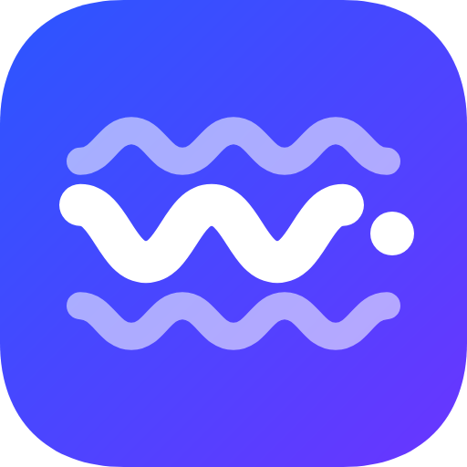
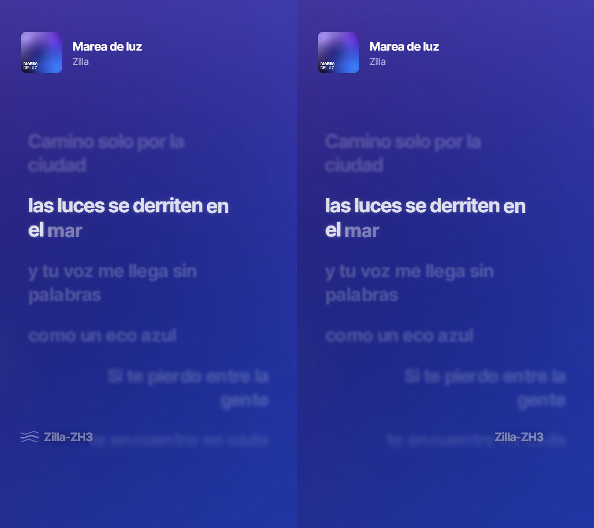
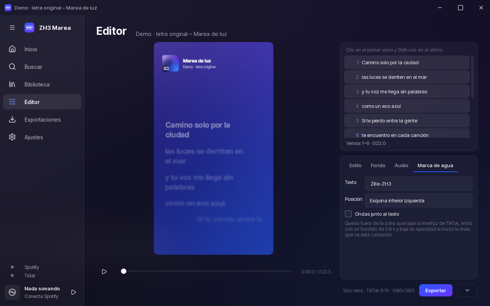
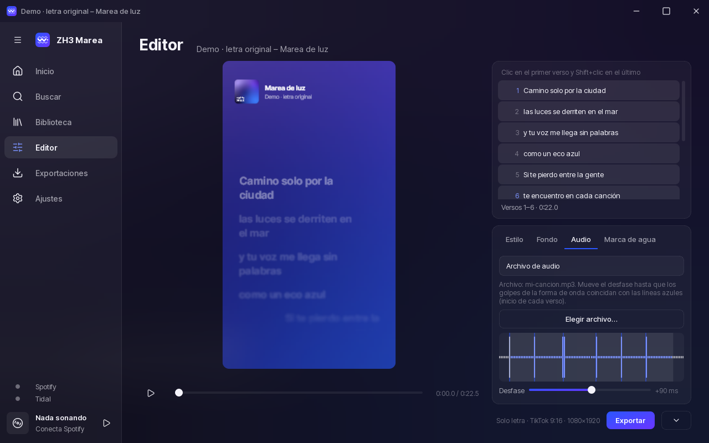
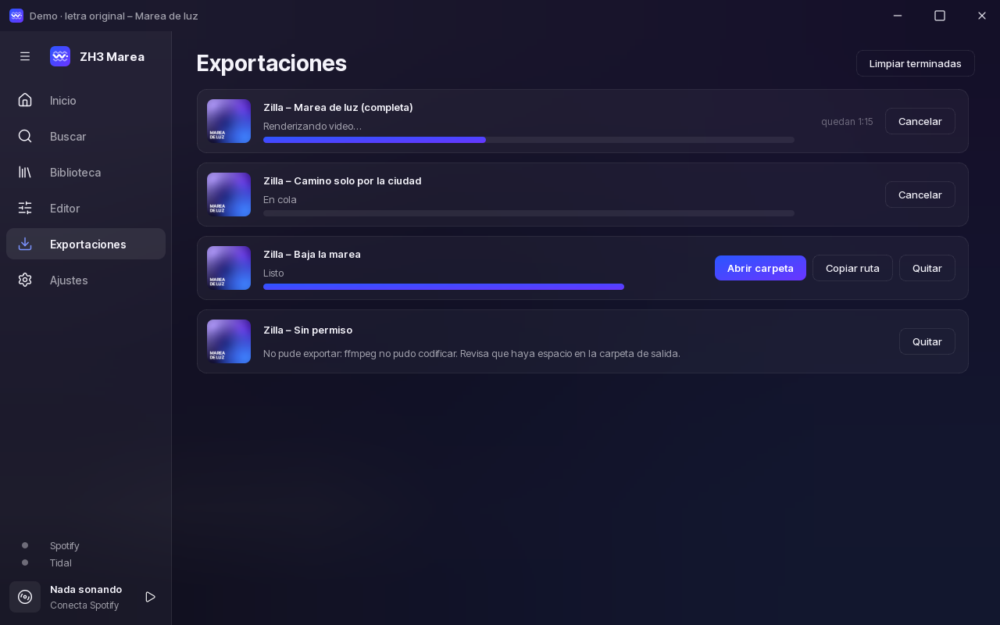
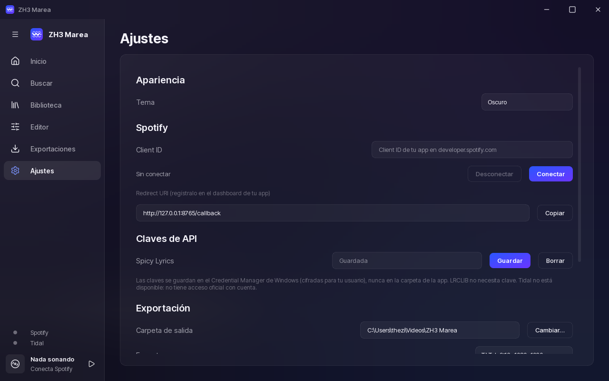
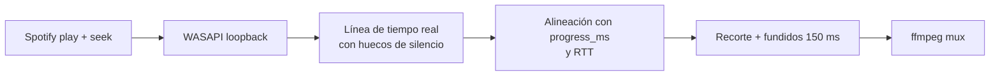

<div align="center">



# 🌊 ZH3 Marea

**Letras sincronizadas sílaba por sílaba, estilo Apple Music, listas para TikTok.**




</div>

Elige una canción, marca el rango de versos y obtén un `.mp4` **1080×1920 a 60 fps** con la letra animada, el fondo hecho con la
portada difuminada y tu marca de agua. App **nativa** de escritorio (sin WebView ni Electron): la preview y el export usan
exactamente el mismo motor, así que lo que ves es lo que sale.

---

## ✨ Qué hace

- 🎤 **Letra por sílaba** con wipe, glow, bloom, micro-vibrato, letras que rebotan en palabras largas, duetos y voces de fondo.
- 🫧 **Fondo vivo**: la portada difuminada en varias capas que se mueven despacio, con interludios en puntos que respiran.
- 🎬 **Tres modos**: solo letra, clip con canción y canción completa.
- 🎞️ **Export determinista**: pasos fijos de 1/60 s; el mismo trabajo da los mismos píxeles, siempre.
- ⚡ **GPU** (OpenGL vía Skia) con respaldo en CPU, y NVENC opcional para codificar.
- 💧 **Marca de agua** editable que respeta la zona segura de TikTok y se aparta de la línea cantada.
- 🎧 **Audio alineado**: loopback de tu propia reproducción de Spotify o archivo propio con forma de onda para ajustar el desfase.
- 🌅 **Outro ajustable**: el menú Outro extiende el rango del clip unos segundos más y desvanece el audio.
- 📝 **Cambia la letra sin perder el proyecto**: «Reemplazar letra con .ttml» en el menú del Editor conserva portada y metadatos.
- 🎚️ **Sincronía automática de letras** (experimental, opcional): alinea una letra con el audio y te deja revisarla.
- 📥 **Cola de exportaciones** con progreso, ETA, cancelar y abrir carpeta.
- 🔐 **Credenciales seguras**: claves y tokens en el Credential Manager de Windows, nunca en archivos.
- 📦 **Portable**: una carpeta, un `.exe`, nada que instalar.

## 🖼️ Capturas

| Editor + marca de agua | Audio y forma de onda |
|:--:|:--:|
|  |  |
| **Cola de exportaciones** | **Ajustes** |
|  |  |

> Las capturas usan la canción demo con letra original y datos simulados.

## ⚡ Inicio rápido

### 📦 Opción A: portable (recomendada)

1. Descarga `ZH3-Marea-portable.zip` de [Releases](https://github.com/zillazh3/ZH3-Marea/releases/latest) y descomprímelo donde quieras.
2. Abre **`ZH3 Marea.exe`**. Listo.

ffmpeg viene incluido. Ajustes, caché y registro viven en `data/` junto al `.exe`, así que mover o borrar la carpeta es todo lo
que hace falta. Si la carpeta es de solo lectura, los datos pasan a `%LOCALAPPDATA%\ZH3 Marea`.

> 🩺 `ZH3 Marea.exe --selftest` exporta 1 s de video y prueba keyring y captura de audio; el resultado queda en `data/selftest.txt`.

### 🛠️ Opción B: desde el código

Necesitas Windows 10/11, Python 3.12 y ffmpeg (en el `PATH`, en `MAREA_FFMPEG` o en `ffmpeg/` junto a la app).

```powershell
git clone https://github.com/zillazh3/ZH3-Marea.git
cd ZH3-Marea
py -3.12 -m venv .venv
.\.venv\Scripts\pip install -r requirements.txt
.\.venv\Scripts\python -m marea.app
```

### 🏗️ Construir tu propio portable

```powershell
.\.venv\Scripts\python tools\build_exe.py --zip   # dist\ZH3 Marea\ y dist\ZH3-Marea-portable.zip
```

> ⚖️ El ffmpeg que se empaqueta es una build GPL (Gyan): respeta su licencia si redistribuyes la carpeta.

## 🎬 Modos de exportación

| Modo | Audio | Cómo funciona |
|---|---|---|
| 📝 **Solo letra** | sin audio | exporta el rango de versos; ideal para poner el **sonido oficial desde TikTok** |
| 🎵 **Con canción** | loopback de Spotify o archivo propio | el rango de versos con el audio recortado, fundidos de 150 ms y **outro** opcional con fade out |
| 💿 **Canción completa** | loopback de Spotify o archivo propio | de principio a fin, con cola, progreso y cancelación |

**Formatos:** 1080×1920 (TikTok), 1080×1080 y 1920×1080 · 60 fps · H.264 (`libx264 -preset slow -crf 16` o NVENC) · AAC 320k ·
etiquetado BT.709 y `+faststart`. El **marcador de inicio** (flash de 1 frame o pitido) te ayuda a sincronizar el sonido oficial.

## 💧 Marca de agua

Pestaña **Marca de agua** del Editor:

- Texto editable (por defecto `Zilla-ZH3`), esquina inferior izquierda o derecha y glifo de ondas opcional.
- Se coloca **por encima del 15 % inferior** y lejos de la columna de botones de TikTok.
- Entra con un fundido de **0.6 s**, con sombra suave y opacidad 40 %.
- Si la línea que se canta baja hasta ella, **baja su opacidad** en vez de taparla.

## 🎵 Spotify

1. Crea una app en <https://developer.spotify.com/dashboard> y activa **Web API**.
2. Registra exactamente este **Redirect URI**: `http://127.0.0.1:8765/callback` (Spotify no acepta `localhost`).
3. En **Ajustes** pega el **Client ID** y pulsa **Conectar**. Se usa PKCE: no hay client secret, y el token se guarda en el
   Credential Manager de Windows.
4. Si tu app está en modo desarrollo, tu cuenta debe estar en la lista de usuarios del dashboard.

Grabar el audio de Spotify (modo «Con canción» → Loopback) **requiere Spotify Premium**: la app pide `play` + `seek`.

## 🎧 Grabar audio por loopback



1. En **Ajustes → Audio** elige el dispositivo de captura. «Probar captura» mide el nivel mientras suena algo.
2. El **desfase** compensa la latencia de tu equipo (positivo = el audio llega tarde).
3. **Voicemeeter / mezcladores virtuales:** el loopback de sus salidas virtuales suele dar silencio. Elige una de sus entradas
   «Voicemeeter Out B1/B2» (aparecen como «· entrada») o un altavoz físico.
4. Durante la grabación no pauses ni cambies de canción, y evita otros sonidos.

¿Sin Spotify? Usa **Archivo de audio**: la pestaña Audio muestra la forma de onda frente al inicio de cada verso para ajustar el
desfase a ojo.

**Medido en hardware real:** latencia de captura 10.5 ± 0.7 ms · clics en el mp4 final con error 0.0 ms (audio local) ·
alineación con Spotify simulada < 40 ms.

## 📝 Letras

| Fuente | Estado | Detalle |
|---|---|---|
| 📄 **TTML** local | ✅ | formato de Apple Music: tiempos por sílaba, duetos y voces de fondo |
| 🌐 **LRCLIB** | ✅ | pública y sin llave; sincronía por línea (por palabra si el `lyricsfile` la trae); caché local |
| 🌶️ **Spicy Lyrics** | ✅ | letra por sílaba de Apple Music o de la comunidad, por id de Spotify; llave de cliente `sl_pk_…` (con «Allow requests with no Origin header») en Ajustes; va primero y LRCLIB queda de respaldo; el crédito se muestra en el Editor |
| 🌀 **Tidal** | ❌ | sin acceso oficial con cuenta; igual puedes grabar su audio por loopback |

## 🎚️ Sincronía automática de letras (experimental)

Alinea una letra con el audio de tu canción (línea → palabra → sílaba, con la vocal solo como aproximación) y te deja **revisarla antes de
exportar un TTML nuevo**. Está **apagada por defecto**: actívala en **Ajustes → Funciones experimentales**; con ella apagada la app se comporta
exactamente igual y no carga nada de esto.

- **Modo A (ya tienes la letra):** abre tu `.ttml` con sílabas y elige **Sincronizar con audio** en el menú del Editor; conserva tu texto, agentes y
  voces de fondo y solo corrige los tiempos. **Modo B (no hay letra):** Whisper propone un borrador que tú corriges y luego se alinea.
- **Revisión:** línea de tiempo con forma de onda, color por confianza, lista de lo que requiere revisión, edición arrastrando o con números,
  escuchar desde cualquier unidad, desfase global aparte, recalcular una sección sin reprocesar la canción y vista previa en el Editor.
- **Tu archivo original nunca se modifica:** el resultado se exporta a un `*.aligned.ttml` nuevo (y un `.alignment.json` con todo el detalle) en la carpeta `letras/` de los datos de la app, no junto a tus clips.
- **Cómo funciona:** corre en un proceso aparte (`sidecar/`, con torch) que se instala solo si lo pides (≈ 4.5 GB más modelos bajo demanda dentro de
  `lab/`; borrar esa carpeta lo desinstala). Necesita una GPU NVIDIA para ser cómodo (probado en una RTX 5060); no se descarga nada sin que lo pidas.
- **Qué esperar:** funciona muy bien con voz clara (~92–97 % de inicios de palabra a ±100 ms) y mucho mejor con **separar la voz** en música densa,
  pero **no es mágico**: en rock saturado o voces muy arrastradas queda por debajo y la app te lo dice marcando más unidades para revisar. Solo
  español e inglés por ahora.
- **Licencias:** los pesos de separación de voz vienen de un repositorio comunitario **sin licencia declarada**: solo para tus pruebas.

## 🔐 Seguridad y datos

- Las **claves de API y tokens** van al **Credential Manager** de Windows (cifrado por usuario). Nada de secretos en `data/`,
  en los ajustes ni en el repo.
- Las consultas a APIs van espaciadas y con caché, respetando sus límites.
- Todo se procesa **en tu equipo**: no hay servidores propios ni telemetría.

## ⚖️ Uso responsable

> [!WARNING]
> **Publicar audio con derechos de autor puede provocar silenciamientos, reclamos o bajas.** La opción más segura es el modo
> **«Solo letra»**: exporta el video sin audio para que le pongas el **sonido oficial desde TikTok**.

- **No se elimina DRM ni se descarga audio por vías no oficiales.** El audio solo sale del loopback de **tu propia reproducción** o
  de **archivos que tú tengas**.
- Grabar lo que suena en tu equipo puede ir contra los términos de uso de tu servicio de streaming. **Eso queda bajo tu
  responsabilidad:** revisa los términos de cada uno.
- Las letras pertenecen a sus autores; la app no las incluye, las consulta de fuentes públicas o de archivos tuyos.

## 🧪 Desarrollo

```powershell
.\.venv\Scripts\python -m pytest tests -q          # ~390 tests (usa ffmpeg y, si hay, OpenGL en subprocesos); los de audio real de la sincronía son opt-in: MAREA_LAB_DIR
.\.venv\Scripts\python tools\measure_loopback.py    # mide la captura con hardware real (suenan clics suaves)
```

### 🗺️ Estructura

```text
marea/
├─ engine/      animación pura: springs, splines, layout, interludios (sin dependencias de UI)
├─ render/      Skia: escena, fondo, texto, GPU/CPU, marca de agua
├─ export/      ffmpeg por pipe, proceso de render aparte, cola e historial
├─ audio/       loopback WASAPI, alineación, audio local, sesión de grabación
├─ providers/   Spotify (PKCE), LRCLIB, TTML
├─ lab/         (experimental) esquema alignment.v1, sesión de revisión, cliente del sidecar, instalador
├─ model/       lyrics: Syllable / Line / Interlude y parsers
└─ ui/          PySide6: ventana, Editor, Exportaciones, Ajustes, tema por tokens
sidecar/        (experimental) proceso aparte con torch y modelos; la app nunca lo importa
tools/          iconos, referencias del motor, build del .exe, mediciones, evaluación de la sincronía
assets/         fuentes, íconos, logo y la canción demo
```

El motor es un port de un prototipo propio en JavaScript (no incluido) y se valida con tests numéricos contra valores congelados en `tests/fixtures/`.

## 🙏 Créditos

El motor de animación se inspira en y porta valores de [Apple Music-like Lyrics](https://github.com/amll-dev/applemusic-like-lyrics) y
[Spicy Lyrics](https://github.com/Spikerko/spicy-lyrics) (ambos AGPL-3.0), y el spring analítico de `spr` de Fraktality. Letras de
[LRCLIB](https://lrclib.net) y Spicy Lyrics. Hecho con [Skia](https://skia.org), [Qt for Python](https://doc.qt.io/qtforpython-6/),
[ffmpeg](https://ffmpeg.org), [PyAudioWPatch](https://github.com/s0d3s/PyAudioWPatch), [Inter Tight](https://fonts.google.com/specimen/Inter+Tight) (OFL) y
[Lucide](https://lucide.dev) (ISC). Lista completa de licencias en [`THIRD_PARTY.md`](THIRD_PARTY.md).

## 📜 Licencia

[**GNU AGPL-3.0**](LICENSE) © 2026 Zilla-ZH3. Puedes usarlo, estudiarlo y modificarlo; si distribuyes una versión modificada o la ofreces como
servicio, debes publicar tu código bajo la misma licencia y conservar los créditos. Apple Music, Spotify, TikTok y Tidal son marcas de sus dueños;
este proyecto no está afiliado a ellos.

## 🛡️ Reportar una vulnerabilidad

Usa **Security → Report a vulnerability** en GitHub (aviso privado). No abras un issue público con datos sensibles.

<div align="center">

Hecho con 🌊 por **Zilla-ZH3**

</div>
